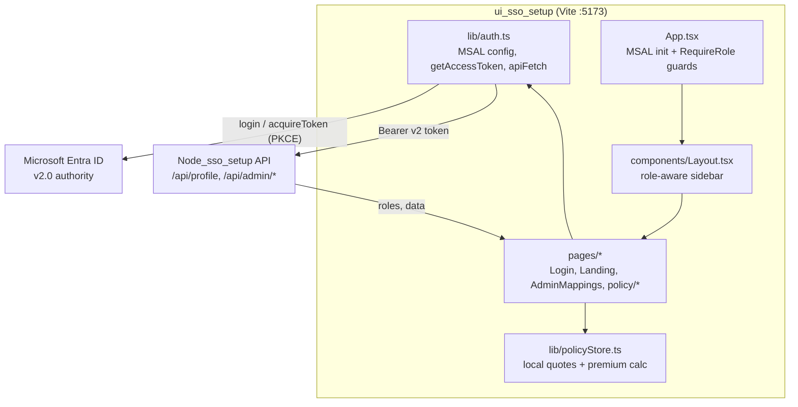
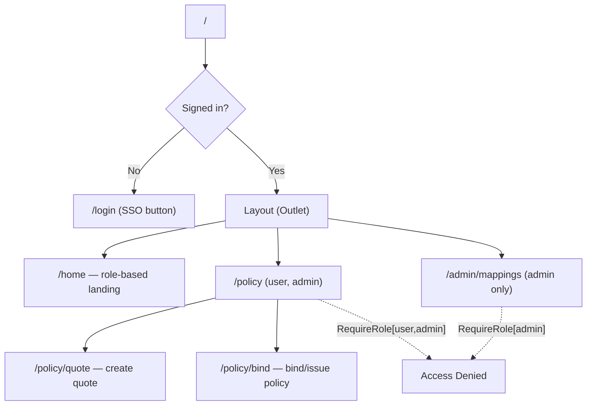

# UI SSO Setup — React SPA

React single-page app that signs users in with **Microsoft Entra ID** via
**MSAL**, calls a protected API with the issued access token, and renders a
**role-based** experience (policy-admin system for underwriters, administration
for admins). It is the frontend of a three-repository SSO reference system.

## Part of a 3-repository system

| Layer | Repository | Description |
| --- | --- | --- |
| **Frontend (SPA)** | **ui_sso_setup** (this repo) | React + MSAL sign-in and role-based UI |
| Backend (API) | [Node_sso_setup](https://github.com/Peddin5739/Node_sso_setup) | Express API, token validation, authorization |
| Database | [DB_sso_setup-Public](https://github.com/Peddin5739/DB_sso_setup-Public) | PostgreSQL `authz` schema (groups → roles) |

---

## Authentication & authorization method

- **Protocol:** OpenID Connect (OIDC) 1.0 on top of **OAuth 2.0**.
- **Flow:** **Authorization Code Flow with PKCE** via `@azure/msal-browser`
  (public client, **no client secret**).
- **Identity provider:** Microsoft Entra ID (Azure AD), authority
  `https://login.microsoftonline.com/<tenant>/v2.0`.
- **Token usage:** MSAL acquires a **v2 access token** for scope
  `api://<api-client-id>/access_as_user` and sends it as
  `Authorization: Bearer <token>` to the API.
- **Authorization in the UI:** roles returned by `GET /api/profile` (derived
  from the user's Entra `groups`) drive routing guards (`RequireRole`) and which
  navigation/pages are visible.

---

## Architecture



### Route map & guards



---

## Configuration

Copy `.env.example` → `.env`:

```env
VITE_AZURE_TENANT_ID=<tenant-id>
VITE_AZURE_CLIENT_ID=<spa-app-client-id>
VITE_AZURE_AUTHORITY=https://login.microsoftonline.com/<tenant-id>/v2.0
VITE_API_SCOPE=api://<api-app-client-id>/access_as_user
VITE_API_BASE_URL=http://localhost:3001
```

> The **SPA app registration** must use platform *Single-page application* with
> redirect URI `http://localhost:5173` and delegated permission to the API's
> `access_as_user` scope (admin-consented).

---

## Run

```bash
npm install
npm run dev       # http://localhost:5173
npm run build     # tsc -b && vite build
npm run preview   # serve production build
```

Start the [API](https://github.com/Peddin5739/Node_sso_setup) on `:3001` and
apply the [database schema](https://github.com/Peddin5739/DB_sso_setup-Public)
first.

---

## Source map

| Path | Responsibility |
| --- | --- |
| `src/lib/auth.ts` | MSAL config, `getAccessToken`, `apiFetch` helper |
| `src/lib/types.ts` | Shared types (`Profile`, `Role`, `GroupRoleMapping`, `Quote`) |
| `src/lib/policyStore.ts` | localStorage quotes/policies + premium calc |
| `src/App.tsx` | MSAL init, routing, `RequireRole` guards |
| `src/components/Layout.tsx` | Role-aware sidebar shell |
| `src/pages/AdminMappings.tsx` | Admin group → role mapping UI |
| `src/pages/policy/*` | Policy home, create quote, bind/issue |

---

## Tech stack

React 19 · Vite 8 · TypeScript 7 · React Router 7 · `@azure/msal-browser` 4.
